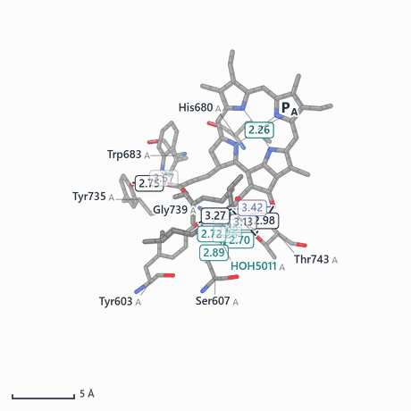
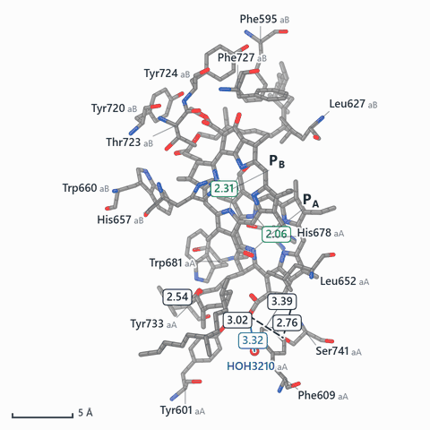
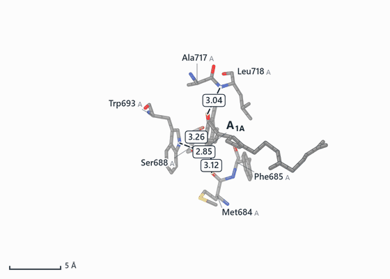
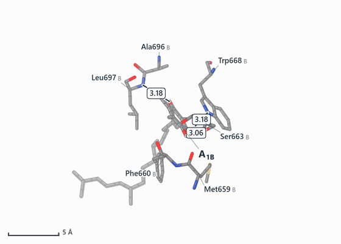
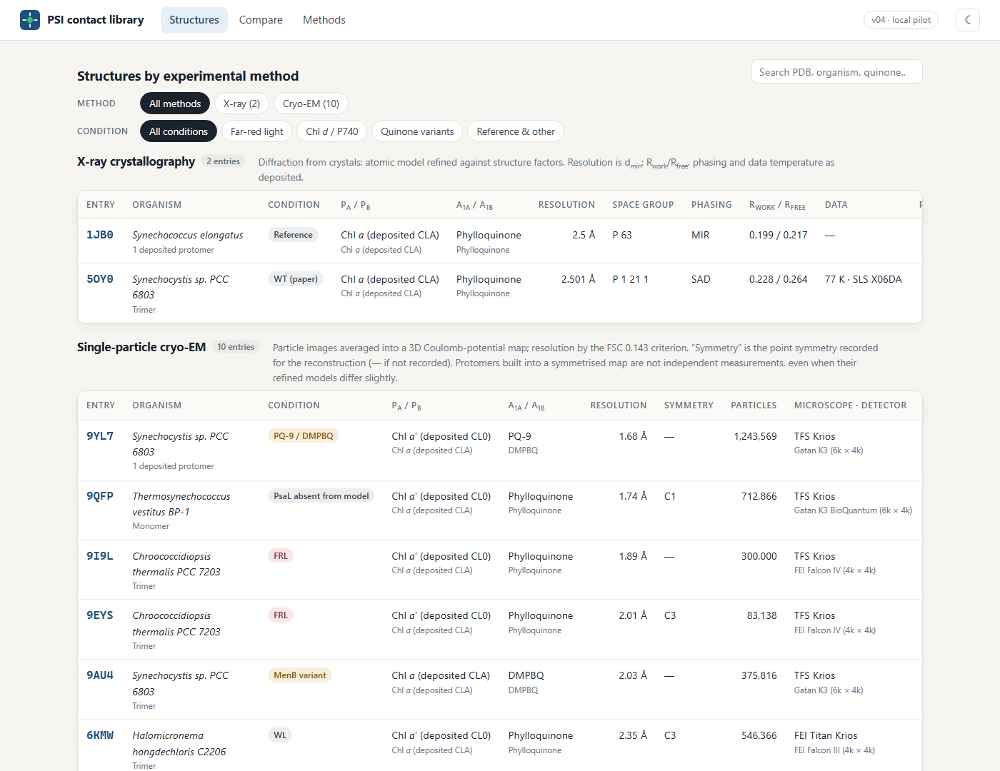
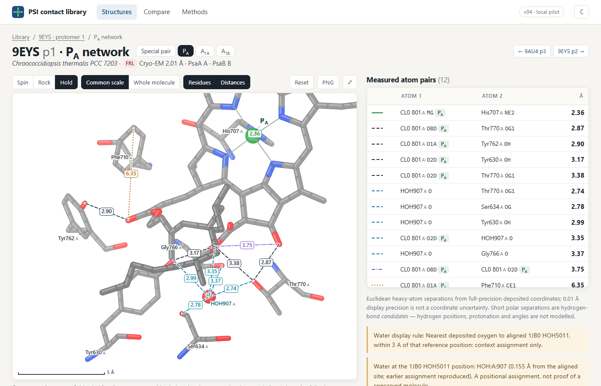
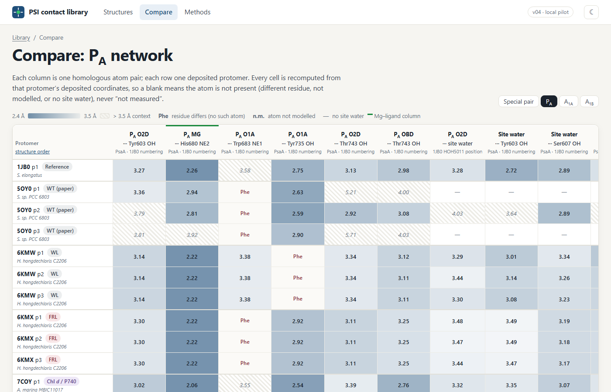
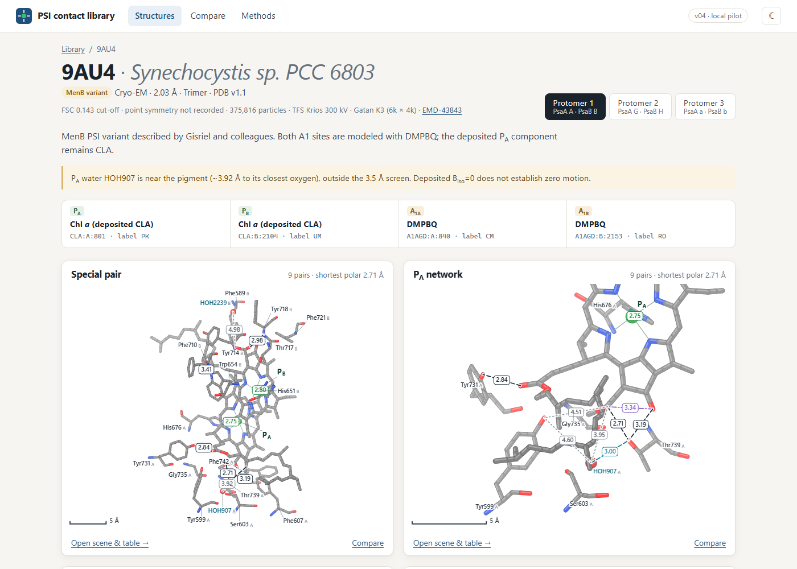
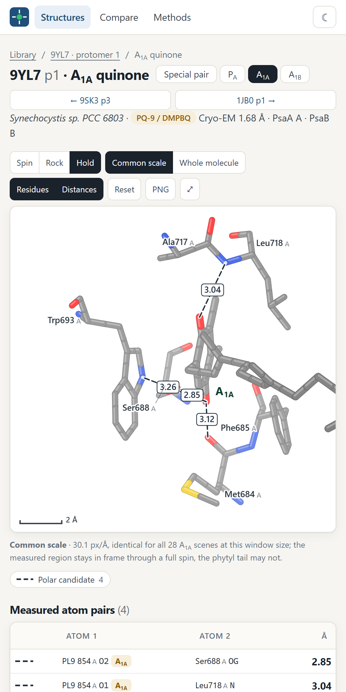

# PSI Contact Atlas

**Heavy-atom separations around the photosystem I special pair, the P<sub>A</sub> chlorophyll network and both A<sub>1</sub> quinone sites, measured from 12 deposited PDB structures (28 protomers, 112 scenes, 752 atom pairs).**

Open the interactive library: **[https://fisicas.github.io/psi-contact-atlas/](https://fisicas.github.io/psi-contact-atlas/)** · or download this repository and open `index.html` in any modern browser (no server, no install, works offline).

> Preview release. Values are recomputed from deposited coordinates and checked independently, but the library has not been peer reviewed. Please read [What it can and cannot tell you](#what-it-can-and-cannot-tell-you) before using a number.

<table>
<tr>
<td align="center"><br><sub><b>1JB0 · P<sub>A</sub> network</b> — <i>S. elongatus</i>, X-ray 2.5 Å</sub></td>
<td align="center"><br><sub><b>7COY · special pair</b> — <i>A. marina</i> Chl <i>d</i> / P740, cryo-EM 2.5 Å</sub></td>
</tr>
<tr>
<td align="center"><br><sub><b>9YL7 · A<sub>1A</sub></b> — PQ-9 (30 of 55 heavy atoms deposited), cryo-EM 1.68 Å</sub></td>
<td align="center"><br><sub><b>9AU4 · A<sub>1B</sub></b> — DMPBQ in the MenB variant, cryo-EM 2.03 Å</sub></td>
</tr>
</table>

<sub>Each loop is drawn by the library’s own viewer from deposited heavy atoms: grey C, blue N, red O, green Mg, yellow S; thicker sticks are the cofactor. Dashed lines are measured separations in Å (dark: polar candidate ≤ 3.5 Å; teal: water-involved; green: Mg–ligand; grey dotted: longer context). The whole scene stays in frame through the full turn.</sub>

## Why these four environments

In PSI, light drives charge separation from the special pair P700 (chlorophylls P<sub>A</sub> and P<sub>B</sub>) along two nearly symmetric cofactor branches, through the A<sub>1</sub> quinones to the iron–sulfur clusters. Two structural features make these sites worth comparing atom by atom:

- **P<sub>A</sub> is asymmetrically hydrogen-bond-capable.** In the 1JB0 reference, P<sub>A</sub> (a Chl *a*′ epimer) sits in a polar network of PsaA Thr743, Tyr603, Ser607, Gly739 and a water, which P<sub>B</sub> lacks ([Jordan et al. 2001](https://doi.org/10.1038/35082000)). The network is a recurring candidate for tuning the special pair’s electronic asymmetry, so its geometry in far-red-light (FRL) PSI, chlorophyll *d* PSI and engineered variants is of direct interest.
- **Each A<sub>1</sub> quinone has one carbonyl near a backbone N–H** (PsaA Leu722 / PsaB Leu706 in 1JB0) and the other near a Trp NE1, a Ser OG and the Met/Phe backbone (PsaA Met688–Phe689). Replacing phylloquinone (the MenB variant with DMPBQ; the PQ-9/DMPBQ entry 9YL7) changes the ring and its substituents while the pocket stays largely conserved.

This library shows those sites side by side, for every deposited protomer, with each distance traceable to two named atoms.

## What you can do with it



- **Browse by experimental method.** X-ray and single-particle cryo-EM entries are grouped separately, with the technique fields read from each deposit (space group, phasing and R<sub>work</sub>/R<sub>free</sub> for X-ray; FSC criterion, point symmetry, particle count, microscope/detector and EMDB map for cryo-EM), and filtered by growth condition (far-red light, Chl *d* / P740, quinone variants).
- **Rotate a scene and read it.** Every scene spins by default; drag to rotate, Ctrl + wheel to zoom. Distance numbers are re-placed every frame next to their own dashed guide, and hovering a guide highlights the matching row of the atom-pair table (and vice versa). *Common scale* keeps one Å-per-pixel across all 28 scenes of an environment; *Whole molecule* keeps every atom in frame through the spin. A 2560-px PNG can be exported from any orientation.



- **Compare one contact across all 28 protomers.** Each column is a homologous atom pair (partner residues mapped to 1JB0 numbering by sequence alignment); each cell is recomputed from that protomer’s coordinates. A blank cell says *why*: the residue differs (e.g. “Phe”), the atom is not modelled, or there is no water at the site.



- **See each structure’s cofactor identities and lineage**, with the deposited component name beside the interpreted pigment (a deposited CLA at P<sub>A</sub> is not silently renamed Chl *a*′), case-sensitive chain IDs, model-lineage notes and verified citations.

<table><tr>
<td width="62%"></td>
<td></td>
</tr></table>

- **Download** per-scene contact tables (full precision, both the class and the original curated annotation), the full compare matrix, and native-identity mmCIF crops for each scene.

## Observations the compare view makes visible

These are statements about the deposited models, not functional conclusions:

- **Residue differences at network positions.** Several entries carry Phe where 1JB0 has Trp683 (5OY0, 6KMX, 9AU4, 9EYS, 9I9L, 9YL7), and white-light 6KMW carries Phe where 1JB0 has Tyr735 while far-red-light 6KMX keeps the Tyr. The Chl *d* entries have Ser where 1JB0 has Thr743.
- **Protomers are not replicates.** Within an entry, values can be nearly identical (largest spread across protomers 0.002 Å in 9AU4 and 0.04 Å in 6KMX) or differ by up to 0.35 Å (6KMW, 9EYS, 9I9L) and more in the X-ray 5OY0 trimer, depending on how symmetry was imposed on the map and model. Neither case is an independent repeat measurement.
- **Unusual separations stay visible.** 5OY0 protomer 3 has long P<sub>A</sub> Mg–His separations; 9AU4 HOH907 sits 3.95 Å from P<sub>A</sub> O2D, outside the 3.5 Å polar screen; 9AU4 Trp693 NE1 is listed as unobserved in its deposition.

## What it can and cannot tell you

| It can | It cannot |
|---|---|
| Give the Euclidean separation between two deposited heavy atoms, from full-precision coordinates, with native chain/residue/atom names. | Confirm a hydrogen bond: hydrogens, protonation states and donor–acceptor angles are not modelled. A short N/O···O separation is a *candidate*. |
| Show which polar atoms and modelled waters sit within hydrogen-bonding distance of P<sub>A</sub>, P<sub>B</sub> and the A<sub>1</sub> carbonyls. | Give the uncertainty of a distance. 0.01 Å is display precision; nominal resolution is not a per-atom error, and local map quality is not shown. |
| Compare a homologous contact across 28 protomers and show where the residue itself differs. | Treat protomers as independent replicates (symmetry or NCS restraints can make them nearly identical by construction). |
| Separate deposited component identity, interpreted pigment name, functional role and chain ID. | Prove a water is conserved or absent, establish Mg coordination geometry or stereochemistry, or establish model ancestry. |

## Structures

| PDB | Organism | Condition | Method | A<sub>1A</sub> / A<sub>1B</sub> | Protomers | Paper |
|---|---|---|---|---|---|---|
| [1JB0](https://www.rcsb.org/structure/1JB0) | *Synechococcus elongatus* | Reference | X-ray 2.5 Å · P 63, MIR phasing | Phylloquinone / Phylloquinone | 1 | [Jordan et al. 2001](https://doi.org/10.1038/35082000) |
| [5OY0](https://www.rcsb.org/structure/5OY0) | *Synechocystis sp. PCC 6803* | WT (paper) | X-ray 2.501 Å · P 1 21 1, SAD phasing | Phylloquinone / Phylloquinone | 3 | [Malavath et al. 2018](https://doi.org/10.1016/j.bbabio.2018.02.002) |
| [9YL7](https://www.rcsb.org/structure/9YL7) | *Synechocystis sp. PCC 6803* | PQ-9 / DMPBQ | Cryo-EM 1.68 Å · symmetry not recorded, EMD-73077 | PQ-9 / DMPBQ | 1 | to be published |
| [9QFP](https://www.rcsb.org/structure/9QFP) | *Thermosynechococcus vestitus BP-1* | PsaL absent from model | Cryo-EM 1.74 Å · C1, EMD-53120 | Phylloquinone / Phylloquinone | 1 | [Boyka et al. 2026](https://doi.org/10.1007/s11120-026-01237-x) |
| [9I9L](https://www.rcsb.org/structure/9I9L) | *Chroococcidiopsis thermalis PCC 7203* | FRL | Cryo-EM 1.89 Å · symmetry not recorded, EMD-52762 | Phylloquinone / Phylloquinone | 3 | [Consoli et al. 2025](https://doi.org/10.1126/science.ado6830) |
| [9EYS](https://www.rcsb.org/structure/9EYS) | *Chroococcidiopsis thermalis PCC 7203* | FRL | Cryo-EM 2.01 Å · C3, EMD-50063 | Phylloquinone / Phylloquinone | 3 | [Consoli et al. 2025](https://doi.org/10.1126/science.ado6830) |
| [9AU4](https://www.rcsb.org/structure/9AU4) | *Synechocystis sp. PCC 6803* | MenB variant | Cryo-EM 2.03 Å · symmetry not recorded, EMD-43843 | DMPBQ / DMPBQ | 3 | [Gisriel et al. 2024](https://doi.org/10.1126/sciadv.adp4937) |
| [6KMW](https://www.rcsb.org/structure/6KMW) | *Halomicronema hongdechloris C2206* | WL | Cryo-EM 2.35 Å · C3, EMD-0726 | Phylloquinone / Phylloquinone | 3 | [Kato et al. 2020](https://doi.org/10.1038/s41467-019-13898-5) |
| [6KMX](https://www.rcsb.org/structure/6KMX) | *Halomicronema hongdechloris C2206* | FRL | Cryo-EM 2.41 Å · C3, EMD-0727 | Phylloquinone / Phylloquinone | 3 | [Kato et al. 2020](https://doi.org/10.1038/s41467-019-13898-5) |
| [9S6P](https://www.rcsb.org/structure/9S6P) | *Acaryochloris marina NIES-2412* | Chl d / P740 | Cryo-EM 2.44 Å · symmetry not recorded, EMD-54627 | Phylloquinone / Phylloquinone | 1 | [Oliver et al. 2026](https://doi.org/10.1126/sciadv.aed7355) |
| [7COY](https://www.rcsb.org/structure/7COY) | *Acaryochloris marina MBIC11017* | Chl d / P740 | Cryo-EM 2.5 Å · symmetry not recorded, EMD-30420 | Phylloquinone / Phylloquinone | 3 | [Hamaguchi et al. 2021](https://doi.org/10.1038/s41467-021-22502-8) |
| [9SK3](https://www.rcsb.org/structure/9SK3) | *Acaryochloris marina NIES-2412* | Chl d / P740 | Cryo-EM 2.63 Å · symmetry not recorded, EMD-54956 | Phylloquinone / Phylloquinone | 3 | [Oliver et al. 2026](https://doi.org/10.1126/sciadv.aed7355) |

Display alignment to 1JB0 is a camera convention, not model ancestry. Lineage notes on each structure page are drawn from the primary papers and deposition records.

## Doing it yourself in PyMOL

Everything the site shows can be reproduced in [PyMOL](https://pymol.org/) (open-source or Schrödinger builds), either from the scene crops in this repository or from the full deposited entries.

### 1 · Open any scene with its script

Every scene has a script in [`downloads/pymol/`](downloads/pymol) (also linked from the scene page under *Downloads & archive*). From the repository root:

```bash
pymol downloads/pymol/1JB0_prot1_P_A.pml
```

The script loads the scene’s mmCIF crop from `downloads/cif/`, applies the library’s colours and stick sizes, draws every measured pair as a PyMOL distance object grouped by class (`Mg_ligand`, `polar_candidate`, `water_polar_candidate`, `longer_context`, `packing`, `intramolecular`), labels residues and roles, and restores the reviewed starting view. The comment above each `distance` line gives the library value. To start from the full deposited entry, replace the `load` line with the `fetch` line given in the script; the same atoms are then selected as `lib_atoms`. All 112 scripts were run in PyMOL 3.1 both ways: every distance object was created and all 1,504 PyMOL distances matched the library to within 0.0001 Å.

### 2 · Measure a site from scratch

```
fetch 1JB0, type=cif
set ignore_case, 0
select PA, 1JB0 and chain A and resi 1011 and resn CLA
select shell, byres (1JB0 and (polymer or resn HOH)) within 5 of PA
hide everything
show sticks, PA or shell
show spheres, (PA and elem MG) or (shell and resn HOH)
set sphere_scale, 0.25
distance polar, PA and elem N+O, shell and elem N+O, 3.5, mode=0
distance mg_ligand, PA and name MG, shell and elem N+O, 3.0, mode=0
get_distance 1JB0 and chain A and resi 1011 and name OBD, 1JB0 and chain A and resi 743 and name OG1
```

- `mode=0` draws **every** heavy-atom pair within the cutoff, which is the quantity this library reports; the library’s per-scene lists are a curated subset of such pairs.
- `mode=2` (also *Action → find → polar contacts*) applies PyMOL’s own hydrogen-bond geometry heuristics, so it can add or drop pairs relative to a plain distance cutoff. It is not a confirmation of a hydrogen bond either.
- Residue numbers differ between organisms. To find the residue at a given 1JB0 position, use the compare page or [`downloads/compare_matrix.csv`](downloads/compare_matrix.csv) (columns `native_partner`, `atom_1`, `atom_2`).

### 3 · Compare one contact across structures

[`tools/pymol_compare_example.py`](tools/pymol_compare_example.py) measures the P<sub>A</sub> 13<sup>1</sup>-keto oxygen (OBD) to the side-chain hydroxyl at the 1JB0 Thr743 position in six entries and prints PyMOL’s value next to the library’s:

```
run tools/pymol_compare_example.py
```

```
1JB0      CLA:A:1011:OBD ... THR:A:743:OG1    PyMOL 2.98 A   library 2.98 A
6KMW      CL0:aA:801:OBD ... THR:aA:752:OG1   PyMOL 3.12 A   library 3.12 A
6KMX      CL0:aA:801:OBD ... THR:aA:772:OG1   PyMOL 3.25 A   library 3.25 A
9EYS       CL0:A:801:OBD ... THR:A:770:OG1    PyMOL 2.87 A   library 2.87 A
9YL7       CL0:A:802:OBD ... THR:A:739:OG1    PyMOL 2.89 A   library 2.89 A
7COY     G9R:aA:3101:OBD ... SER:aA:741:OG    PyMOL 2.76 A   library 2.76 A
```

Each pair is listed with native identities because the partner differs between entries (Thr OG1 in most, Ser OG in the chlorophyll *d* entry 7COY). Set `CIF_DIR` in the script to use local files instead of fetching.

### 4 · Make your own spinning GIF

```
pymol downloads/pymol/9YL7_prot1_A1A.pml
viewport 800, 600
mset 1 x120
util.mroll(1, 120, 1)
set ray_trace_frames, 1
mpng frames/9YL7_A1A_
```

Create the `frames` folder first. `util.mroll` turns the scene once about the vertical axis over 120 frames, and `mpng` writes `9YL7_A1A_0001.png` … `0120.png`. Assemble them with, for example, `ffmpeg -framerate 20 -i frames/9YL7_A1A_%04d.png -vf "split[a][b];[a]palettegen[p];[b][p]paletteuse" 9YL7_A1A.gif`. (The GIFs in this README were drawn by the site’s own viewer, not by PyMOL.)

### 5 · Things that commonly go wrong

- **Chain IDs are case-sensitive.** 9AU4 has chains `A`, `G` and `a`; 6KMW, 6KMX, 7COY and 9SK3 use two-letter IDs such as `aA`. Keep `set ignore_case, 0`.
- **Author vs label numbering.** PyMOL reads author chain and residue numbers from mmCIF by default (`cif_use_auth`), as the library does. The `label_asym_id` chains are different and are listed in the CSVs.
- **Alternate locations.** Check `alt` before measuring. The library uses the highest-occupancy position; none of the atoms in its scenes has an alternate location.
- **Quinone atom names are not interchangeable.** Phylloquinone (PQN) carbonyls are O1/O4; PL9 and A1AGD use O1/O2. The carbonyl next to the Leu backbone N is PQN O4 but PL9/A1AGD O1.
- **Hydrogens.** Most deposits have none. `h_add` places idealised hydrogens; they are not observations.
- **Labels can overlap** at some angles. Move them with `set label_position` or by dragging in editing mode.

## How the numbers are produced and checked

- **Selections** (scene atoms, measured pairs, label anchors, water rules) come from an earlier curated build rendered in PyMOL and reviewed scene by scene. In the P<sub>A</sub> and special-pair scenes, deposited waters within 5 Å of the diagnostic pigment oxygens/Mg are retained; nothing is invented where the deposit has no water.
- **Every value is re-derived from the deposited mmCIF files** (SHA-256 in [`data/sources.json`](data/sources.json)): 16,101 scene atoms matched (max 0.0005 Å, from earlier 0.001 Å rounding), 752 distances recomputed at full precision. Cofactor bonds drawn in the viewer match the CCD bond graphs for all 140 cofactor residues. The 1JB0-numbering alignment reproduces all 133 previously curated P<sub>A</sub>-network residue mappings.
- **Corrections relative to the earlier build** are listed on the site’s Methods page: 5 values that change in the last displayed digit and 3 contacts reclassified as longer context.
- **Contact classes** follow one rule: Mg involved → Mg–ligand; same residue → intramolecular; C or S involved → packing; > 3.5 Å → longer context; water involved → water polar candidate; otherwise polar candidate.

### Verify it yourself

```bash
pip install gemmi
python tools/verify_public.py --cif-dir cif_cache --download
```

This downloads the twelve entries from RCSB and recomputes every coordinate, displayed distance and compare-matrix cell, and reports any entry whose file has been revised since this build.

## Repository layout

| Path | Contents |
|---|---|
| `index.html`, `css/`, `js/` | The static site; `js/viewer.js` is a dependency-free Canvas 2D molecular viewer. |
| `data/atlas.js` | Structure metadata, technique fields, citations, compare matrices, verification summary. |
| `data/views/*.js` | One file per scene: native atom identities and coordinates, bonds, measured pairs, label anchors, starting camera. |
| `data/sources.json`, `data/verification.json` | Deposited-file hashes and the build’s verification record. |
| `downloads/` | Contact CSVs (per scene and combined), compare matrix CSV, native-identity mmCIF crops. |
| `downloads/pymol/` | One PyMOL script per scene (same atoms, measured pairs, colours and starting view). |
| `media/` | The images in this README. |
| `tools/verify_public.py` | Independent recomputation from deposited files. |
| `tools/pymol_compare_example.py` | PyMOL example: one homologous contact across six entries. |

## Licence

- **Code** (`index.html`, `css/`, `js/`, `tools/`, `downloads/pymol/`): [MIT](LICENSE).
- **Data, figures and text** (`data/`, the rest of `downloads/`, `media/`, this README and the site text): [CC BY 4.0](LICENSE-DATA.md). You may reuse them with attribution.
- **Atomic coordinates** come from the Protein Data Bank (CC0). Please still cite the PDB entries and their primary papers.

## How to cite

Citation metadata is in [`CITATION.cff`](CITATION.cff); GitHub shows it as *Cite this repository*.

> M. R. Nelson, *PSI Contact Atlas: heavy-atom contacts around the photosystem I special pair and A<sub>1</sub> quinone sites* (preview, 2026), https://github.com/Fisicas/psi-contact-atlas

Please also cite the PDB entries and primary papers for the structures you use.

Author: Michael Raymond Nelson.
